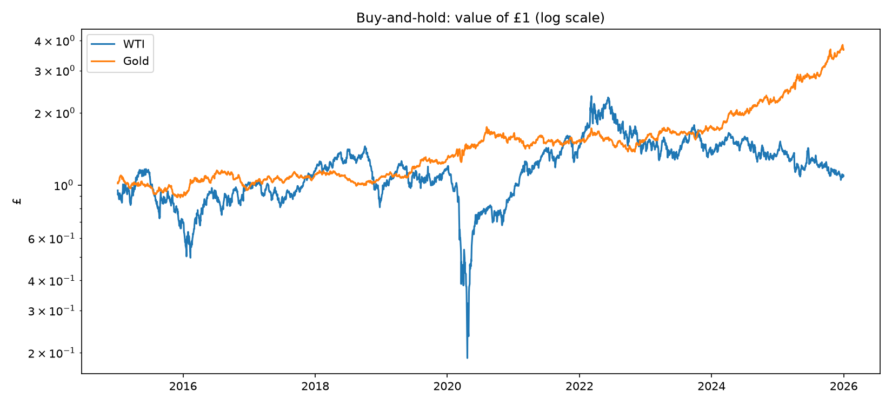
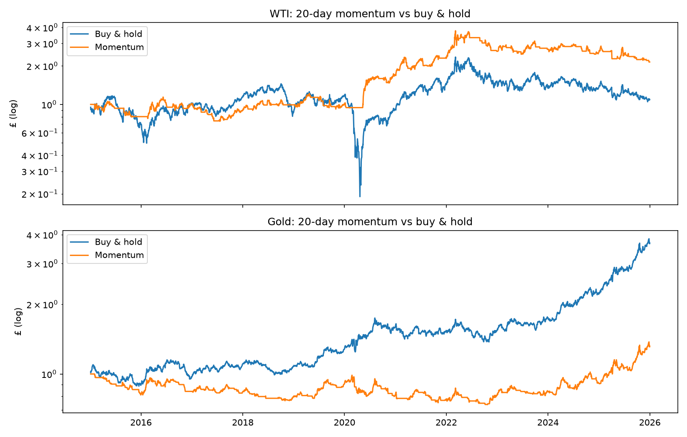

# Do simple trading rules beat buy and hold on Oil (WTI) and Gold?


Three strategies were tested on WTI and Gold against buying and holding in the date range 2015 - 2025.

No, none of the three rules beat buy and hold significantly on either asset, with the one significant result (Gold Momentum) being significantly worse than buying and holding.


## 1. The question


The question that this project is used to answer is whether the following strategies perform better than just buying and holding the assets Gold and WTI (West Texas Intermediate): 20 day momentum , Mean Reversion and Trend following. All these strategies are explained below.


## 2. Data


In this project, all the data comes from Yahoo Finance, taking only the Close column between the first date of 2015 and the last date of 2025. The data is Continuous Futures (CL=F for WTI and GC=F for Gold) with 2,766 trading days

Continuous Futures means the price rolls to the next contract each month.

I removed one date from WTI - 20th April 2020. This is as a result of the negative price that occurred on this day. I removed this date outright due to the fact that this price would produce returns that physically can't exist. I chose to remove the anomaly rather than smooth it out and replace it with a number in between the prices of the 17th and 21st as this may introduce unwanted lookahead bias for the strategies influencing the results. I didn't remove the price from the 21st as dropping this price too would turn the return of £1.09 to £1.99, which overstates WTI.

After removing this date, I checked the extremes of the data, ensuring the worst and best days look like real market moves.


## 3. Strategies


|     Strategy     |                                                  Rule                                                  |
|------------------|--------------------------------------------------------------------------------------------------------|
|  Buy and hold    | Buy with £1 on day 1 and hold                                                                          |
|  20-day momentum | buy if today's price is above the price 20 days ago, otherwise flat                                    |
|  Mean reversion  | find the z score of todays price compared to the 20 day mean, buy if less than -1 sell when 0 or more  |
|  Trend following | buy when 50 day moving average exceeds that of 200 day                                                 |

All the strategies are either long or flat, never short. All the parameters were fixed in advance (20 day means and returns etc) to avoid overfitting as a result of tuning


## 4. Method


I tested six strategy-asset pairs, calculating the daily difference between the strategy's return and buy-and-hold's return on the same day, and used a two sided paired t-test to check whether the mean difference was significantly different from zero. As a result of running six tests, I applied Bonferroni (α = 0.05/6) and Holm corrections.

- The signals are traded the next day (using shift(1) to ensure there is no lookahead bias).
- Metrics used: CAGR, Annualised Volatility, Sharpe (with risk-free rate of 0) and Max drawdown
- The costs work by charging a fee in bp each time the position changes: for each strategy, a break-even fee is calculated. This number is the fee per trade required to completely eat up the lead over buy and hold.


## 5. Results


| Asset | Strategy      | CAGR | Volatility | Sharpe | Max drawdown | Trades/yr | p-value | Significant? | Break-even (bp) |
|-------|---------------|------|------------|--------|--------------|-----------|---------|--------------|-----------------|
|  WTI  | Buy & hold    | 0.8% | 47.5%      | 0.26   | −86.9%       | —         | —       | —            | —               |
|  WTI  | Momentum      | 7.2% | 25.1%      | 0.40   | −43.0%       | 23        | 0.85    | No           | 27              |
|  WTI  | Mean reversion| 0.8% | 37.2%      | 0.22   | −80.1%       | 16        | 0.63    | No           | 0.5             |
|  WTI  | Trend 50/200  | 2.4% | 24.5%      | 0.22   | −52.4%       | 1.6       | 0.57    | No           | 99              |
| Gold  | Buy & hold    | 12.5%| 15.5%      | 0.84   | −21.2%       | —         | —       | —            | —               |
| Gold  | Momentum      | 2.5% | 12.4%      | 0.26   | −26.3%       | 29        | 0.0005  | YES (Worse)  | -               |
| Gold  | Mean reversion| 5.6% | 8.3%       | 0.70   | −11.1%       | 14        | 0.066   | No           | —               |
| Gold  | Trend 50/200  | 8.6% | 13.2%      | 0.69   | −28.9%       | 1.4       | 0.11    | No           | —               |

Some strategies in the table look more promising than others and may mislead one to believe that they should be better, for example WTI - momentum. it looks the most promising out of all strategies with a high Sharpe and CAGR percentage, however the p value of 0.85 after the t-test indicates that this case of outperformance can't be differentiated from pure luck. Adding to that, despite the CAGR of Momentum on WTI being 9x higher than buy and hold, the average daily difference, annualised, is -2.3% a year (not on table; from step 6). This is explained later. Another thing that can be noticed is how all strategies appear to perform worse than buying and holding on Gold, though only one strategy is statistically significant: Momentum; meeting both the significance level of 0.05 and the Bonferroni corrected significance.







## 6. What I found


As mentioned before, some strategies appeared to perform much better than buy and hold, especially on WTI, with higher CAGR percentages across the board and one strategy possession a higher Sharpe ration than buy and hold, however, the t-tests surprisingly reveal that this can't be distinguished from luck, with extremely high p values (0.85 0.57) exhibiting this characteristic.

Returning to the daily difference issue from the Results section, after some research, I found this comes as a result of Volatility drag. Buy and hold has 47.5% Volatility which costs roughly 11% a year of compounding (vol^2/2). Momentum almost halves that volatility so is exposed to much less drag, increasing its CAGR. Therefore, the higher CAGR comes from avoiding big swings, not from picking better days. This is the cause of the extremely high p value of 0.85 as the t-test compares average daily returns and doesn't see the advantage.

Though what these strategies did do on WTI is reduced overall risk, with all strategies experiencing a lesser maximum drawdown and lesser volatility across the board, though this wasn't accounted for in the t-test which compared mean returns

Only one strategy met the significance value, however in a way we didn't want. The strategy, Momentum, on the asset Gold performed much worse than buy and hold, with real significance, below 0.05 and that of the Bonferroni corrected significant value, displaying that this strategy genuinely performs worse over this sample than buying and holding on Gold ( CAGR of 2.5% vs 12.5% and Sharpe of 0.26 vs 0.84 whilst also having a deeper max drawdown)


## 7. Limitations


- The Sample size (2015-2025) may be affecting the results and may be too small to even find an edge as the edge compared to buy and hold may be small (like a coin with bias of 51% to tails)

- Extremes happen more often than they should (The assets have "fat" tails) - Extremes of 5 standard deviations or more are far more common than they should be within this 10 year sample, notably in 2020 due to COVID. This in turn means the mean is a lot less reliable than the t-test assumes. 

- The t-test only compares mean returns and doesn't test risk-adjusted performance (maybe one of the strategies can be considered better when the risk is accounted for, potential case for WTI Momentum and other WTI strategies)

- The price jump between contracts as a result of the data being from continuous futures may affect the results of the experiment

- When flat, money doesn't sit, it is also affected by interest when sitting in the bank, this isn't accounted for and could potentially change the equation (money that is flat here earns 0% when it may be earning X% interest depending on the rates)


## 8. Next steps


- I would scale the volatility of each strategy to match that of buy and hold and re-run the t-tests. This would show which strategies are better when risk-adjusted rather than comparing only the raw-returns with no attention being paid to how risky the strategy is.

- I would also run an out of sample split - I would pick the best settings on 2015 - 2021 before testing these untouched on the 2022-2025 range to test whether an "edge" carries over onto unseen data

- I would adjust the test so that when flat, rather than the money doing nothing, which is unrealistic, it would earn interest based off of the conditions at the time so sitting in cash isn't punished.


## 9. How to run it


The files are labelled clearly in their steps however, here is the list anyway:

```bash
python3.12 -m venv .venv
source .venv/bin/activate
pip install -r requirements.txt

python step1_load_data.py        # download WTI and gold prices, check them, save to data/
python step2_buy_and_hold.py     # buy-and-hold baseline and metrics
python step3_momentum.py         # 20-day momentum
python step4_mean_reversion.py   # 20-day z-score mean reversion
python step5_trend_following.py  # 50/200-day moving-average crossover
python step6_stats.py            # paired t-tests, Bonferroni and Holm  -> results/stats.csv
python step7_costs.py            # transaction costs and break-even     -> results/costs.csv
```

